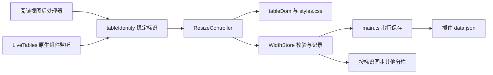

# 项目入门指南：Table Width Scroll

核对日期：2026-11-12。本文中的代码路径相对插件根目录；可点击的文档链接相对本文位置。

## 项目概述与工作区边界

Table Width Scroll 是独立的 Obsidian 插件，为普通 Markdown 表格提供列宽调整、冻结前 N 列与横向滚动。表格可见区域跟随笔记正文宽度，阅读视图和 Live Preview 共用列宽与冻结记录，保留原生单元格编辑，不改写笔记。

当前上层工作区包含三个工程：

| 工作区目录 | 用途 | 声明的应用兼容性 |
| --- | --- | --- |
| `./table-width-scroll/` | 当前开发工程，独立 Git 仓库，版本 0.2.1 | Obsidian ≥1.14.4，允许移动端加载 |
| `./gridlock-tables-master/` | 列宽调整、原生组件增强的参考源码，版本 0.1.2 | Obsidian ≥1.14.4，允许移动端加载 |
| `./table-style-tweaks-master/` | 容器滚动及表格样式的参考源码，版本 1.0.1 | Obsidian ≥1.8.7，仅桌面端 |

上层目录有 CodeGraph 索引，但没有 Git 仓库或统一 npm 工程。两个参考目录是没有 Git 元数据的源码副本；日常构建、测试和 Git 操作进入当前插件目录。新插件不需要同时启用两个参考插件。

## 技术栈

以下版本来自当前锁文件及本地已安装依赖。

| 层级 | 技术 | 版本或约束 |
| --- | --- | --- |
| 开发运行环境 | Node.js、npm | 本轮使用 24.14.1、11.11.0；项目未配置 engines，当前 Playwright 要求 Node.js ≥20 |
| 语言 | TypeScript | 5.9.3，严格模式，目标 ES2021 |
| 宿主接口 | Obsidian | 编译依赖固定 1.14.4，实际运行由宿主提供 |
| 编辑器 | CodeMirror state / view | 固定 6.7.6 / 6.43.13 |
| 构建 | esbuild | 0.25.5，生成 CommonJS `./main.js` |
| 测试 | Vitest / Playwright | 2.1.9 / 1.65.0 |
| 持久化 | Obsidian loadData / saveData | 插件 `data.json`，无数据库、ORM 或后台服务 |

工程没有 Python 或 Conda 依赖。Obsidian、CodeMirror、Electron 与 Node 内置模块在生产构建中作为外部模块处理；安装包不包含 node_modules。

## 架构与一次列宽调整的数据流



1. `./src/main.ts` 加载保存数据，注册阅读后处理器、CodeMirror 扩展、窗口与文件事件、设置页及重置命令。
2. 阅读视图通过 Markdown 区块源码定位表格；Live Preview 通过原生 `.cm-table-widget` 的文档位置定位，观察组件重建后重新装饰。
3. `./src/tableIdentity.ts` 跳过 frontmatter 和围栏代码块，用「笔记路径、解析后的表头、相同表头出现次数」生成 JSON 标识；两种视图使用同一规则。
4. 拖动前记录所有列宽，将像素位移换算为表格字体的 ch 单位，仅修改目标列；`./src/tableDom.ts` 同时设置全部列宽与表格总宽度，CSS 保持外层容器受正文宽度约束。
5. 松开指针后校验并保存，按表格标识刷新其他分栏。`persist()` 在调用时快照数据并串行 saveData，失败时记录错误并显示 Notice。取消手势恢复已保存状态。
6. `./src/freezeStore.ts` 区分全局默认、每表覆盖和显式不冻结；`./src/freezeDom.ts` 在原生单元格上应用 sticky，并按实际列宽计算偏移。窗口空间不足时暂时减少生效列数，不改保存值。
7. 原生 widget 重建时，`LiveTables` 跟踪已装饰节点并释放脱离 DOM 的冻结观察器；卸载时同时清理存活和已移除的表格。
8. `./src/freezeMenu.ts` 接入原生行、列和普通单元格菜单，提供阅读视图右键和命令入口。只适配当前菜单实例的显示及卸载方法，保留原生项目、选择和关闭回调。

## 关键入口与修改位置

| 任务 | 路径与职责 |
| --- | --- |
| 生命周期、阅读接入、设置、命令、持久化 | `./src/main.ts` |
| Live Preview 接入、文档缓存与组件销毁 | `./src/livePreview.ts` |
| 拖动、取消、键盘调整、跨视图同步 | `./src/resizeController.ts` |
| 滚动容器、手柄、列组、宽度应用与清理 | `./src/tableDom.ts` |
| 表格解析与稳定标识 | `./src/tableIdentity.ts` |
| 列宽限制、数据校验、文件与目录改名迁移 | `./src/widthStore.ts` |
| 全局冻结默认、每表覆盖、校验与路径迁移 | `./src/freezeStore.ts` |
| 冻结单元格偏移、尺寸变化与清理 | `./src/freezeDom.ts` |
| 原生菜单、阅读右键、冻结选择弹窗与命令 | `./src/freezeMenu.ts` |
| 正文约束、滚动及手柄样式 | `./styles.css` |
| 生产打包、外部模块、许可证注入 | `./scripts/build.mjs` |
| 三文件安装目录与 ZIP | `./scripts/package.ps1` |
| 插件 ID、作者、版本与最低宿主版本 | `./manifest.json`，同时核对 `./package.json` |
| 数据单元测试 | `./tests/data.test.ts` |
| 冻结数据语义、显示、字节不变和生命周期 | `./tests/freezeStore.test.ts`、`./tests/freeze.spec.ts` |
| 六点选择、原生菜单保留、显示时序和弹窗清理 | `./tests/freezeMenu.spec.ts`；`./tests/mockObsidian.ts` 模拟单槽 onHide 和显示后不能 addItem 的约束 |
| 布局、交互、视图和生命周期测试 | `./tests/layout.spec.ts`；`./tests/harness.ts`、`./tests/mockObsidian.ts` 提供模拟宿主 |

`./docs/` 保存设计、入门、验收及 Release 说明；`./dist/table-width-scroll/` 是可安装目录。`./tests/.generated/`、测试报告及 node_modules 是生成内容，ZIP 留在本地并被 Git 忽略。插件根目录的 `./main.js` 与安装目录内的三个运行文件已被 Git 跟踪，源码变更后需要核对产物差异。

## 项目约定

- 文件主要使用 camelCase，类和接口使用 PascalCase；两空格缩进、单引号、分号与当前源码保持一致。TypeScript 开启 strict、noUncheckedIndexedAccess 与 noImplicitReturns。
- 模块采用直接导入；ResizeController 通过 ResizeHost 接收存储、保存和视图遍历能力。数据解析保持独立于 Obsidian。
- 列宽以 ch 保存，下限 4ch、上限 300ch，默认每列至少 6ch；不改写 Markdown 笔记。损坏数据被忽略，列数不匹配时恢复默认布局。
- 冻结默认值为 1，旧数据直接兼容；冻结列数最多为总列数减一，空间不足时为滚动区域保留至少 48px 或可见宽度 20%。data.json 的 defaultFrozenColumns 和 frozenColumns 与旧 widths 字段并存。
- 增强原生组件，保留单元格编辑权；观察子节点变化并合并到动画帧，装饰必须幂等。关闭、重置、销毁和卸载时先取消未完成手势，再清理自身 DOM、事件与观察器。
- 样式使用 tws 前缀，通过 `body.tws-enabled` 和所属视图控制作用域，笔记可用 tws-off 停用。兼容性变动需同时验证阅读视图与 Live Preview。
- 新插件提交描述使用中文；冻结功能在 feature/frozen-columns 分支开发，用户确认 0.2.1 功能后授权推送，并快进合并到 main。此次合并没有冲突或源码变动，既有测试结果继续适用；不据此推断通用的分支命名和 PR 约定。参考副本的 Git 历史不可用。
- 新插件未配置 GitHub Actions、lint 脚本或覆盖率命令。Gridlock 参考副本配置了构建、lint、单元测试及标签发布工作流，Table Style Tweaks 配置了标签发布工作流；这些配置不适用于新插件的自动发布。

## 常见任务与验证

在插件根目录使用 PowerShell，命令脚本先设置：

```powershell
$ErrorActionPreference = 'Stop'
$OutputEncoding = [Console]::InputEncoding = [Console]::OutputEncoding = New-Object System.Text.UTF8Encoding
$PSDefaultParameterValues['*:Encoding'] = 'UTF8'
```

| 任务 | 命令 | 注意事项 |
| --- | --- | --- |
| 按锁文件安装依赖 | `npm ci` | 本轮复用现有依赖，未重新安装 |
| 开发监听 | `npm run dev` | 监听构建并生成源码映射，不执行 TypeScript 检查 |
| 类型检查与生产构建 | `npm run build` | 输出 `./main.js`，嵌入完整 MIT 许可文本 |
| 数据逻辑测试 | `npm test` | Vitest 匹配 `./tests/**/*.test.ts` |
| 浏览器测试 | `npm run test:browser` | Playwright 匹配 `./tests/**/*.spec.ts`，单 worker；先生成测试 harness |
| 创建安装包 | `npm run package` | 必须先构建；该命令只复制运行文件并压缩，清理范围为 `./dist/` |

浏览器依次寻找 TWS_BROWSER_PATH、本机 Chrome、Edge；均不存在时使用 Playwright 默认浏览器，需该浏览器已安装。自定义路径可用 `$env:TWS_BROWSER_PATH` 设置。PowerShell 中运行外部命令后，应检查 `$LASTEXITCODE`，非零时停止后续步骤；单独设置 ErrorActionPreference 无法保证原生命令失败即中止。

最近的验证结果和安装包核对见 `./verification.md`，冻结设计与专项范围见 `./frozen-columns.md`。参考工程未作为本插件依赖，也没有运行其构建或测试。

浏览器测试运行实际插件源码、真实 CodeMirror 和模拟 Obsidian API；不能替代真实应用验收。最低版本和 isDesktopOnly 是 manifest 声明，不代表移动端及所有主题组合已经验收。当前范围是顶层 Markdown 表格；嵌套表格、HTML 合并单元格、同表头表格互换顺序等边界见验收文档。

## 继续阅读

- [用户安装与使用说明](../README.md)
- [项目执行与维护约束](../AGENTS.md)
- [设计与模块职责](./design.md)
- [冻结列设计与专项实现](./frozen-columns.md)
- [测试证据、排障约束与真实应用验收](./verification.md)
- [人工验收用笔记](./test-note.md)
- [0.1.0 Release 说明](./releases/0.1.0.md)
